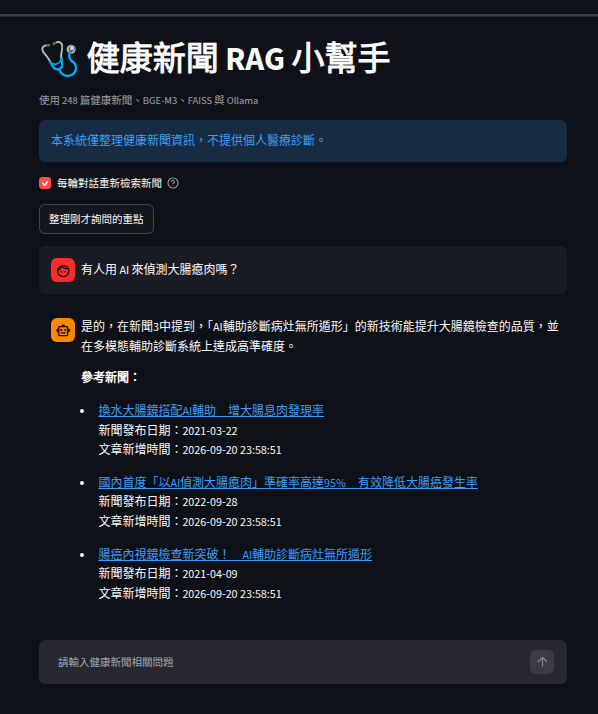
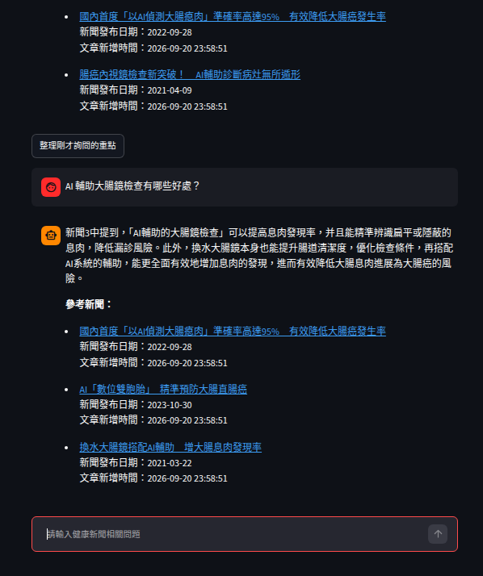
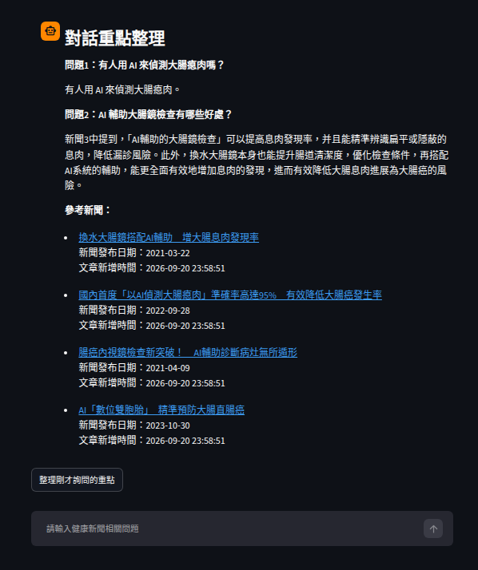
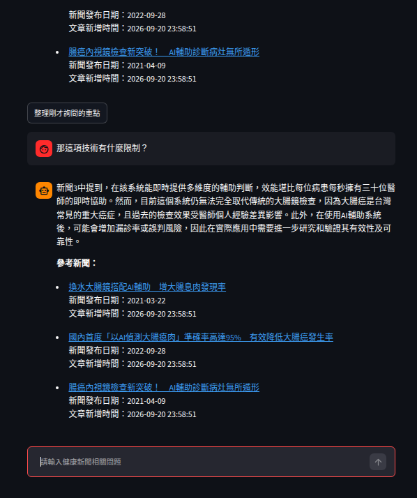

# 健康新聞 RAG 小幫手

## 1. 專案介紹

本專案使用 RAG（Retrieval-Augmented Generation，檢索增強生成）技術，建立以健康新聞為知識來源的繁體中文健康諮詢小幫手。

透過網路爬蟲、SQLite、Ollama、Sentence Transformers、FAISS 與 Streamlit，讓使用者可以詢問健康新聞相關問題、進行多輪對話，並查看回答所參考的新聞來源。

本系統僅提供健康新聞資訊整理，不取代專業醫療診斷。

## 2. 開發環境與技術

- 作業系統：Ubuntu 24.04
- Python：3.12
- 新聞來源：健康醫療網
- 資料庫：SQLite
- 新聞摘要模型：Ollama `gemma4:e4b`
- RAG 問答模型：Ollama `qwen2.5:0.5b`
- 向量模型：`BAAI/bge-m3`
- 向量索引：FAISS
- 網頁介面：Streamlit

## 3. 系統功能

1. 爬取健康醫療網新聞，取得標題、連結、全文等資料。
2. 使用地端模型產生新聞摘要。
3. 將新聞資料及摘要儲存至 SQLite。
4. 使用 BGE-M3 將摘要轉換成向量。
5. 使用 FAISS 建立向量索引，進行語意檢索。
6. 使用 Ollama 產生健康新聞問答內容。
7. 使用 Streamlit 提供網頁操作介面。
8. 使用 Checkbox 控制每輪對話是否重新檢索新聞。
9. 支援多輪對話及對話重點整理。
10. 回答後列出參考新聞標題、連結及日期。

## 4. 資料庫設計

使用 `news.db` 儲存新聞資料。

主要欄位包含：

| 欄位 | 說明 |
|---|---|
| `id` | 新聞流水號 |
| `title` | 新聞標題 |
| `link` | 新聞連結 |
| `content` | 文章全文 |
| `summary` | 文章摘要 |
| `date` | 新聞發布日期 |
| `created_at` | 資料新增時間 |
| `reporter` | 記者資訊 |
| `img_path` | 圖片路徑 |

目前資料庫包含 248 筆新聞。

## 5. 系統處理流程

健康醫療網新聞 → 爬蟲取得資料 → Ollama 產生摘要 → SQLite 儲存 → BGE-M3 摘要向量化 → FAISS 檢索 → Ollama 產生回答 → Streamlit 顯示回答與新聞來源。

## 6. 安裝與執行

### 6.1 建立 Python 虛擬環境

在專案的 `RAG` 目錄執行：

```bash
python3 -m venv .venv
source .venv/bin/activate
```

### 6.2 安裝必要套件

```bash
python -m pip install \
  numpy==2.5.4 \
  faiss-cpu==1.15.1 \
  sentence-transformers==6.2.0 \
  streamlit==1.66.1 \
  ollama
```

其他套件依照 `crawl_data.py`、`app.py` 等程式的匯入需求安裝。

### 6.3 準備 Ollama 模型

安裝並啟動 Ollama 服務後執行：

```bash
ollama pull gemma4:e4b
ollama pull qwen2.5:0.5b
ollama list
```

新聞摘要生成所使用的模型，請依 `crawl_data.py` 中的設定準備。

### 6.4 建立向量索引

```bash
python make_index.py
```

目前驗收結果：

- 新聞數量：248 筆
- 向量數量：248
- 向量維度：1024
- 索引類型：`IndexIDMap`

`vector.index` 不包含在 GitHub Repository 中，需在本機自行建立。

### 6.5 啟動網頁

```bash
python -m streamlit run app.py
```

開啟 Terminal 顯示的 Local URL，即可使用健康新聞 RAG 小幫手。

## 7. 功能測試

### 問題一

有人用 AI 來偵測大腸瘜肉嗎？

測試結果：系統能檢索相關健康新聞，並使用地端模型產生回答。



### 問題二

AI 輔助大腸鏡檢查有哪些好處？

測試結果：系統能根據相關新聞整理 AI 輔助檢查的優點。



### 對話重點整理

系統能整理先前詢問的問題及回答重點，並列出相關參考新聞。



### 多輪對話測試

取消重新檢索的 Checkbox 後，追問：

「那這項技術有什麼限制？」

測試結果：系統沿用上一輪檢索的新聞，並產生後續回答。模型仍可能出現文字編碼異常、回答不夠精確或缺乏來源支持的敘述。



## 8. 專案檔案說明

| 檔案 | 功能 |
|---|---|
| `crawl_data.py` | 爬取新聞與產生摘要 |
| `init_db.py` | 建立 SQLite 資料庫並匯入新聞 |
| `make_index.py` | 建立 FAISS 向量索引 |
| `query.py` | 新聞向量檢索範例 |
| `rag_chat.py` | Ollama RAG 問答與 Chat API |
| `app.py` | Streamlit 網頁 |
| `news.db` | SQLite 新聞資料庫 |
| `news_data.json` | 新聞資料 |
| `news_list.json` | 新聞清單 |

## 9. 已知限制

- 小型地端模型可能出現重複回答、簡體中文或特殊字元。
- 生成內容可能不完全符合新聞原文，應透過參考連結核實。
- Checkbox 控制是否重新檢索，並非是否保留對話歷史。
- 本系統不提供個人化診斷或治療建議。

## 10. 參考資料

- [健康醫療網](https://www.healthnews.com.tw/)
- [Ollama](https://docs.ollama.com/)
- [Sentence Transformers](https://www.sbert.net/)
- [FAISS](https://github.com/facebookresearch/faiss)
- [Streamlit](https://docs.streamlit.io/)
